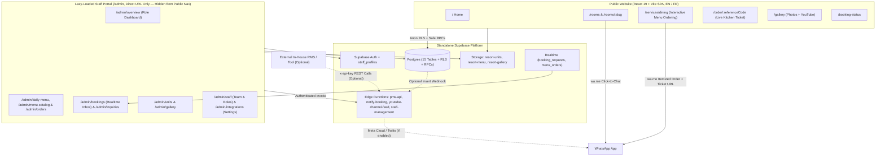

# Architecture Overview

New Waves Resort runs as a **100% standalone** React 19 + Supabase hospitality platform. Any external facility software or PMS interacts exclusively through optional convenience APIs (`pms-api`) and generic reference columns without creating runtime or schema coupling.

---

## High-Level System Diagram

---

## Database Schema & Row Level Security (`0001_initial_schema.sql`)

A `private` schema holds `private.get_staff_role()` (`SECURITY DEFINER`, `SET search_path = ''`, execute granted only to `authenticated`) so role checks remain fast and avoid recursive RLS lookups.

### Public Tables (15 Total — RLS Enabled on All)

| Table | Purpose | Public Access (`anon`) | Staff Access (`authenticated`) |
| :--- | :--- | :--- | :--- |
| `staff_profiles` | Links `auth.users` ID to role (`admin`, `manager`, `front_desk`, `chef`) | None | Read own row; `admin` manages all |
| `site_settings` | Public property info, WhatsApp number, optional Kitchen WhatsApp number, YouTube Channel ID, check-in/out times, currency rates, `saker_landing_image_url` | `SELECT` where `is_public = true` | `admin`, `manager` CRUD |
| `room_types` | 1-/2-/3-bedroom suites, canonical `XAF` price, capacity, amenities, Storage photo JSON, optional `external_ref` | `SELECT` where `is_published = true` | `admin`, `manager` CRUD (`front_desk` reads all) |
| `room_unavailability` | Date blocks (`[start_date, end_date)`) with optional `external_ref` | `SELECT` | `admin`, `manager`, `front_desk` CRUD |
| `booking_requests` | Website/WhatsApp booking requests (`WEB-YYYYMMDD-XXXX`), `external_sync_status`, `external_reference` | **None** (create & lookup via RPCs only) | `admin`, `manager`, `front_desk` read/insert/update; `admin` delete |
| `menu_items` | Master Dish Catalog (EN/FR copy, `price_xaf`, `category`, `dietary_tags`, `allergens`, Storage image) | `SELECT` where `is_active = true` | `admin`, `manager`, `chef` CRUD |
| `menu_item_internal_meta` | Internal kitchen cost (`cost_xaf`), `prep_station`, and `plating_notes` | None | `admin`, `manager`, `chef` CRUD |
| `daily_menus` | Per-date header (`service_date`, titles, chef notes, `status`: `draft`/`published`/`archived`) | `SELECT` where `status = 'published'` | `admin`, `manager`, `chef` CRUD |
| `daily_menu_entries` | Dishes placed into `breakfast` / `lunch` / `dinner` / `all_day`, order, price override, `is_available`, badge | `SELECT` via published parent menu | `admin`, `manager`, `chef` CRUD |
| `menu_orders` | Interactive food orders (`ORD-YYYYMMDD-XXXX`, unguessable `view_token`, fulfillment, location, status timestamps) | **None** (create & view via RPCs only) | `admin`, `manager`, `chef`, `front_desk` read/update |
| `menu_order_items` | Line-item dish snapshots, dietary/allergen metadata, quantity, unit/line `XAF`, and per-dish preparation notes | **None** (returned via `get_menu_order_by_token`) | `admin`, `manager`, `chef`, `front_desk` read |
| `gallery_media` | Supabase Storage photos + YouTube video IDs/URLs (`image` \| `youtube`) | `SELECT` where `is_published = true` | `admin`, `manager` CRUD |
| `contact_inquiries` | Contact page form submissions | `INSERT` only (validated) | `admin`, `manager`, `front_desk` read/update |
| `newsletter_subscribers` | Footer email signups (`email`, `language`) | `INSERT` only (validated) | `admin`, `manager` read/delete |
| `api_keys` | SHA-256 hashed scoped keys (`nwr_live_...`) for optional external integrations | None | `admin` CRUD |

### RPC Functions

- `public.get_available_room_types(p_check_in, p_check_out, p_adults, p_children)` (`SECURITY INVOKER`) — Computes available unit count per suite using half-open `[check_in, check_out)` overlap logic against `room_unavailability`.
- `public.create_booking_request(...)` (`SECURITY DEFINER`) — Validates dates, guest details, and remaining unit capacity; creates a collision-retried `WEB-YYYYMMDD-XXXX` booking request; returns a safe confirmation JSON without granting table `SELECT` to `anon`.
- `public.lookup_booking_status(p_reference_code, p_email)` (`SECURITY DEFINER`) — Returns limited guest-safe booking status metadata only when both reference code and guest email match.
- `public.create_menu_order(...)` (`SECURITY DEFINER`) — Enforces active catalog pricing/daily overrides server-side, blocks sold-out dishes, persists `menu_orders` + `menu_order_items`, and returns `ORD-YYYYMMDD-XXXX` + unguessable `view_token`.
- `public.get_menu_order_by_token(p_reference_code, p_token)` (`SECURITY DEFINER`) — Returns itemized order ticket metadata when `view_token` matches (masking `internal_notes` and `prep_station` for non-staff) or when the caller is authenticated staff (`admin`, `manager`, `chef`, `front_desk`).
- `public.clone_daily_menu(p_source_date, p_target_date)` (`SECURITY INVOKER`) — Allows culinary staff to clone entries from a previous date (e.g. yesterday) into a target date draft.

### Storage Buckets (`0002_storage_buckets.sql`)

| Bucket | Max File Size | Allowed MIME Types | Public Read | Write Roles |
| :--- | :--- | :--- | :--- | :--- |
| `resort-units` | 10 MB | `image/jpeg`, `image/png`, `image/webp` | Yes | `admin`, `manager` |
| `resort-menu` | 5 MB | `image/jpeg`, `image/png`, `image/webp` | Yes | `admin`, `manager`, `chef` |
| `resort-gallery` | 10 MB | `image/jpeg`, `image/png`, `image/webp` | Yes | `admin`, `manager` |

---

## Edge Functions (`supabase/functions/`)

| Function | JWT Verify | Auth Model | Responsibility |
| :--- | :--- | :--- | :--- |
| `pms-api` | `false` | `x-api-key` header (SHA-256 hash in `api_keys`) + scope check | Convenience REST API for pulling bookings (`sync_status=pending`), acking/updating bookings, reading/updating rooms & date blocks, managing menu/daily menus, and posting gallery items |
| `notify-booking` | `false` | Optional `x-webhook-secret` header | Receives `booking_requests` insert webhook payload; supports `WHATSAPP_PROVIDER = none \| meta_cloud \| twilio` |
| `youtube-channel-feed` | `true` | Supabase Auth JWT + `admin` or `manager` role | Resolves single YouTube video oEmbed titles (`url`) and fetches recent channel uploads from public YouTube Atom XML (`channel_id=UC...`) |
| `staff-management` | `false` | Public zero-PII `status`; one-time `bootstrap` when zero staff exist; Admin JWT for team actions | Enables in-app first-admin creation on `/admin/login` and full Chef/Front Desk/Manager/Admin user CRUD inside `/admin/staff` |

---

## Frontend Architecture & Route Map

- **Fallback Mode**: When `VITE_SUPABASE_URL` / `VITE_SUPABASE_PUBLISHABLE_KEY` are absent (`frontend/src/lib/supabase.js`), hooks (`useSiteSettings`, `useRoomTypes`, `useDailyMenu`, `useGallery`) automatically render `frontend/src/lib/fallbackData.js` so demos and builds never crash.
- **Public Routes**:
  - `/` (`Home`), `/story` (`OurStory`), `/rooms` (`Accommodations`), `/rooms/:slug` (`UnitDetail`), `/booking-status` (`BookingStatus`)
  - `/experiences` (`Section`), `/services/dining` (`Dining`), `/order/:referenceCode` (`OrderDetail`), `/services/culinary` (`AtlanticGastronomy`), `/services/intellectual-talks` (`IntellectualTalk`), `/services/transfers` (`DiplomaticTransfers`), `/services/expeditions` (`VolcanicExpeditions`), `/services/fleet` (`PremiumFleet`), `/services/library` (`FisiyLibrary`)
  - `/gallery` (`GalleryPage`), `/contact` (`ContactPage`), `/dialogues` & `/foundation` (`ComingSoon`), redirects `/book` -> `/rooms` and `/dining` & `/menu` -> `/services/dining`, fallback `*` (`NotFound`)
- **Staff Portal (`/admin`, lazy-loaded chunks; direct URL `/admin` or `/admin/login` — not linked in public navigation)**:
  - `/admin/login` (sign-in + automatic first-time Admin setup when no staff exist) -> role-routed to:
    - `/admin/overview` (`admin`, `manager`, `front_desk`, `chef`)
    - `/admin/bookings` (`admin`, `manager`, `front_desk`)
    - `/admin/orders` (`admin`, `manager`, `chef`, `front_desk`)
    - `/admin/daily-menu` (`admin`, `manager`, `chef`)
    - `/admin/menu-catalog` (`admin`, `manager`, `chef`)
    - `/admin/units` (`admin`, `manager`)
    - `/admin/gallery` (`admin`, `manager`)
    - `/admin/inquiries` (`admin`, `manager`, `front_desk`)
    - `/admin/staff` (`admin`)
    - `/admin/integrations` (`admin`)

---

## SEO Build Pipeline

1. `vite build` bundles JS/CSS into `frontend/dist/`.
2. `frontend/scripts/generate-sitemap.mjs` builds `dist/sitemap.xml` across 14 static routes plus published suite `/rooms/:slug` routes (fetched from Supabase if configured, otherwise fallback starter slugs) and omits `/admin`.
3. `frontend/scripts/prerender.mjs` writes static HTML entrypoints with per-route `<title>`, `<meta name="description">`, canonical URLs, OpenGraph, Twitter Cards, and JSON-LD into `dist/<route>/index.html`.
4. `frontend/scripts/verify-helpers.mjs` validates YouTube parsing, currency math, WhatsApp links, JSON-LD generators, EN/FR translations, sitemap rules, and prerendered HTMLs.
